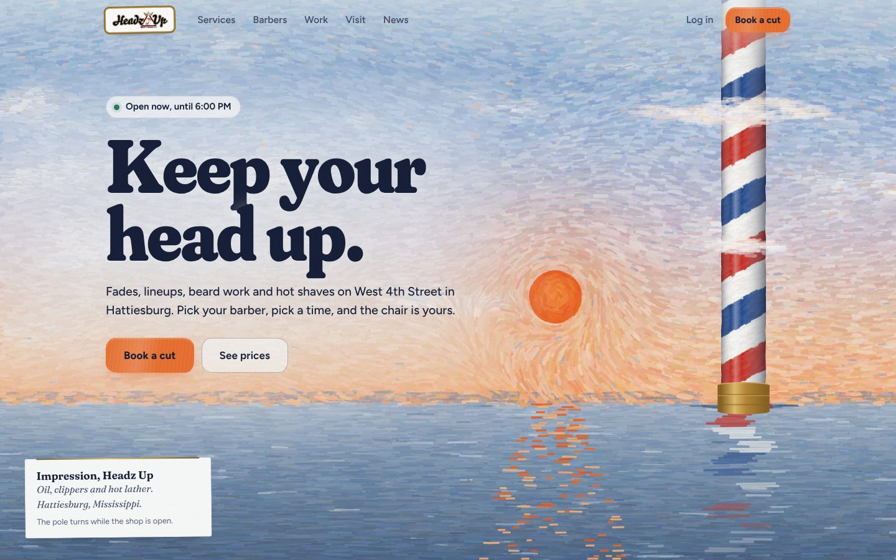
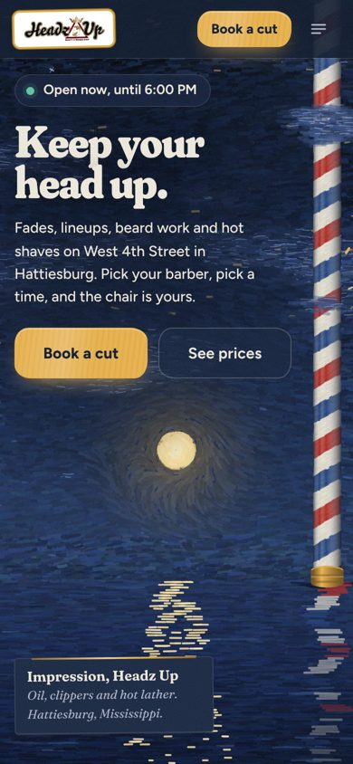
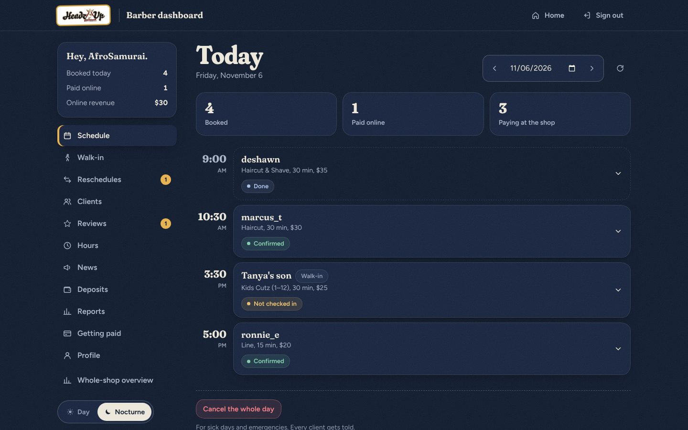

# HEADZ UP Barbershop

A production barbershop booking and management platform, built and deployed
solo. Real clients, live payments, and a full notification system, from
architecture to deployment.

**Live site:** [headzupp.com](https://headzupp.com)

## Tech stack

| Layer | Technology |
| --- | --- |
| Frontend | Next.js 16, React 19, CSS Modules, Canvas 2D |
| Backend | Django REST Framework, Python |
| Database | PostgreSQL |
| Hosting | Vercel (frontend), Railway (backend) |
| Payments | Stripe Connect |
| Email | SendGrid |
| SMS | Twilio (A2P 10DLC) |
| Push notifications | Web Push API (VAPID) |
| Auth | JWT (SimpleJWT), role-based access control |
| CI/CD | GitHub Actions |
| PWA | Service worker, web app manifest |

## Features

- **Real-time booking engine:** availability from barber schedules, time-off blocks and walk-in slots
- **Stripe Connect:** payments go straight to the barber's bank account, with an automatic $1.50 platform fee per transaction
- **Notifications:** email, SMS and push across all 14 booking triggers
- **PWA:** installable on iOS and Android, works offline
- **Role-based dashboards:** separate client and barber portals with their own permissions
- **Strikes and deposits:** fees escalate automatically for no-shows and late cancellations
- **Client management:** VIP flags, notes, booking history and strike tracking
- **Mass messaging:** email and SMS blasts to all clients
- **News feed:** barber posts that push to every client
- **A2P 10DLC compliance:** registered SMS campaign with US carriers
- **Painted interface:** an Impressionist/Surrealist design system with a generative canvas painter, day and night themes
- **CI/CD:** automated deploys through GitHub Actions

## Screenshots

| Day | Nocturne, on a phone |
| --- | --- |
|  |  |



## Local setup

```bash
git clone https://github.com/AshantiC22/headzup-barbershop-website.git
cd headzup-barbershop-website

# Backend
cd BACKEND
python -m venv venv && source venv/bin/activate
pip install -r requirements.txt
cp .env.example .env   # fill in your keys
python manage.py migrate
python manage.py runserver

# Frontend (second terminal)
cd FRONTEND/frontend
npm install
echo "NEXT_PUBLIC_API_URL=http://localhost:8000" > .env.local
npm run dev
```

More on the frontend in [FRONTEND/frontend/README.md](../FRONTEND/frontend/README.md).
